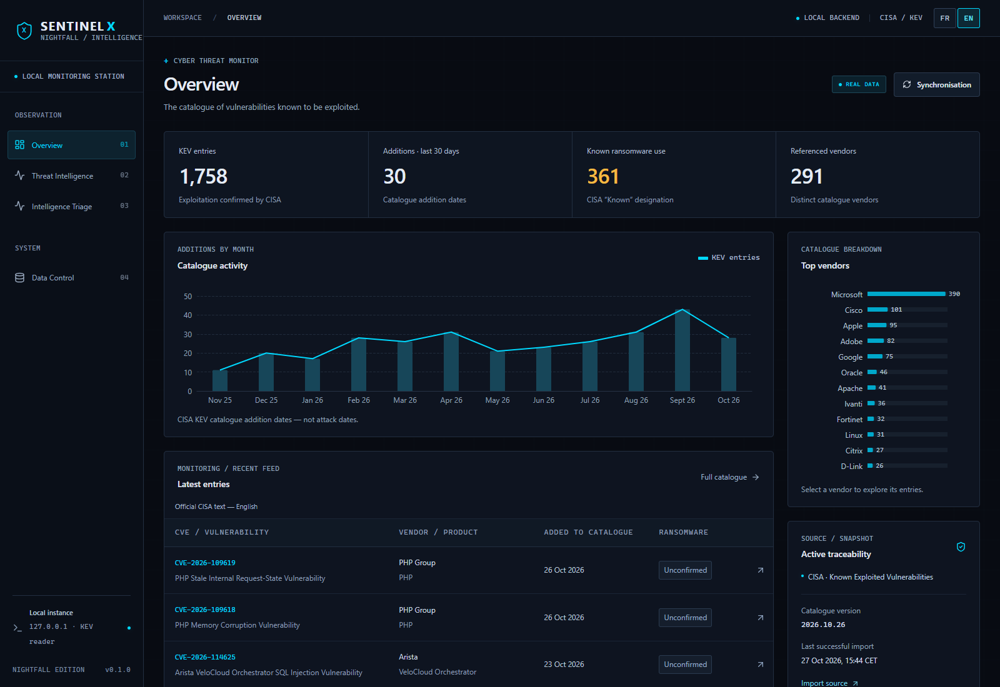

# SENTINEL X — NIGHTFALL

**Prototype open source expérimental de renseignement cyber défensif — JLV LABS.**

Apache-2.0 · [English](README.md) · [Contribuer](CONTRIBUTING.md)

## Présentation des sources candidates v0.2.2

`VERSION` et les métadonnées du paquet frontend indiquent **0.2.2**. Ce candidat
local n'est ni un tag ni une release v0.2.2 publiés. Cet arbre
source n'établit pas lui-même une publication ou une disponibilité distante ; consulter
les [Releases GitHub](https://github.com/JLV-73/sentinel-x/releases). L'installation
ci-dessous est distincte du tableau et du démarrage historiques.

| Domaine | État dans cet arbre source | Limite |
|---|---|---|
| NIGHTFALL / triage | Implémentation locale existante | Collectes explicites ; voir les contrats des sources ci-dessous. |
| GHSA | Pilote borné | Une CVE demandée ; couverture non exhaustive. |
| Fixture DIGITAL FORTRESS | Démonstration locale expérimentale | HTTPS en boucle locale et DNS/pair simulés, pas un audit Internet. |
| Import / rapport | Import JSON local et export HTML expérimentaux | Observations déclarées, ni authentifiées ni vérifiées indépendamment. |
| Observation HTTPS | Candidat Windows expérimental | Une tentative HEAD autorisée ; protections et cycle de vie non entièrement qualifiés. |

Voir les [limites DIGITAL FORTRESS v0.2.2](docs/DIGITAL_FORTRESS_V022.fr.md), le
[guide local](docs/DIGITAL_FORTRESS_LOCAL.md) pour la démonstration et l’import, les
notes historiques v0.2.0 [FR](docs/RELEASE_v0.2.0.fr.md) / [EN](docs/RELEASE_v0.2.0.md).

« Implémenté » décrit les sources, sans prétendre à une recette d'exécution récente,
une certification de sécurité ou une aptitude à la production.

## Installer les sources candidates (Windows)

Utiliser un nouveau dossier isolé accessible en écriture, jamais une installation
opérationnelle ni ses données. Ouvrir PowerShell normalement, sans administrateur.
Prérequis : Windows 11, Git, Python 3.11, Node.js 24 et npm ; vérifier
`git --version`, `py -3.11 --version`, `node --version` et `npm.cmd --version`.
Arrêter au premier échec. Les commandes suivantes sont pour PowerShell, pas cmd.exe
ni Git Bash.

1. **Choisir une source**, puis ouvrir PowerShell à sa racine. Pour des modifications
   non committées, utiliser une copie source isolée préparée séparément de
   l'*ensemble de l'arbre de travail courant*, fichiers candidats non suivis compris ;
   exclure `.git`, `.venv`, `node_modules`, caches, bases, sauvegardes et autres
   données privées. Un clone Git seul n'inclut pas les modifications ni les fichiers
   non suivis. Sinon, lorsque le commit exact existe en local, cloner son dépôt local
   dans un nouveau dossier et sélectionner ce commit.
   Remplacer ci-dessous le chemin local, la destination neuve et le SHA complet
   vérifié ; ce n'est pas une release distante :

   ```powershell
   $ErrorActionPreference = "Stop"
   $Source = 'C:\path\to\local\repository'
   $Destination = 'C:\path\to\new\sentinel-x-candidate'
   $CandidateCommit = '<verified-full-candidate-commit-sha>'
   if (Test-Path -LiteralPath $Destination) { throw "Destination exists; choose a new directory." }
   git clone --no-checkout -- "$Source" "$Destination"
   if ($LASTEXITCODE -ne 0) { throw "Local clone failed." }
   Set-Location -LiteralPath $Destination
   git checkout --detach $CandidateCommit
   if ($LASTEXITCODE -ne 0) { throw "Candidate checkout failed." }
   git rev-parse HEAD
   if ($LASTEXITCODE -ne 0) { throw "Commit verification failed." }
   ```

   Vérifier que HEAD affiché est le SHA candidat vérifié. HEAD détaché est normal.
   Un checkout de commit ne comprend pas les modifications non committées.

   **Alternative stable (v0.2.1, sans les changements du candidat v0.2.2) :**
   confirmer le tag et la Release sur GitHub Releases, puis
   depuis un nouveau dossier parent accessible en écriture :

   ```powershell
   if (Test-Path -LiteralPath .\sentinel-x) { throw "sentinel-x already exists. Use a new parent folder; do not delete it." }
   git clone --branch v0.2.1 https://github.com/JLV-73/sentinel-x.git
   if ($LASTEXITCODE -ne 0) { throw "Clone failed. Stop here." }
   Set-Location .\sentinel-x
   ```

   Un HEAD détaché est normal. Continuer à l'étape 2 depuis la racine du nouveau clone.
2. À la racine de la copie ou du clone choisi, installer les dépendances verrouillées :

   ```powershell
   $ErrorActionPreference = "Stop"
   py -3.11 -m venv .venv
   if ($LASTEXITCODE -ne 0) { throw "venv creation failed." }
   New-Item -ItemType Directory -Force -Path .cache/pip,.cache/tmp,.cache/npm | Out-Null
   $env:TEMP = Join-Path (Get-Location) ".cache/tmp"
   $env:TMP = $env:TEMP
   $env:npm_config_cache = Join-Path (Get-Location) ".cache/npm"
   .\.venv\Scripts\python.exe -I -m pip --isolated install --cache-dir .cache/pip -r backend/requirements-lock.txt
   if ($LASTEXITCODE -ne 0) { throw "Python dependency install failed." }
   npm.cmd --prefix frontend ci --no-audit --no-fund
   if ($LASTEXITCODE -ne 0) { throw "npm install failed." }
   ```

   Le verrou Python et `frontend/package-lock.json` fixent les versions. Ces
   installations peuvent nécessiter Internet ou des caches locaux suffisamment
   remplis ; ce document n'affirme aucun accès réseau. Les variables ne concernent
   que cette session PowerShell.
3. **Acquérir le schéma de validation CISA**, distinct du catalogue KEV :

   ```powershell
   .\.venv\Scripts\python.exe -I tools/bootstrap_schema.py
   if ($LASTEXITCODE -ne 0) { throw "Schema bootstrap failed." }
   ```

   Le schéma n'est pas dans Git. Le bootstrap télécharge la révision officielle
   épinglée en HTTPS et vérifie son SHA-256, ou vérifie sans réseau un fichier local
   déjà identique ; il n'écrase jamais des octets différents. Hors ligne, fournir
   d'abord le schéma exact vérifié dans `backend/app/kev_schema.json`, sinon
   s'arrêter. Voir [installation du schéma](docs/SCHEMA_SETUP.md) ; ne contourner
   ni TLS ni l'empreinte.
4. Lancer `.\START_SENTINEL.cmd` et ouvrir soi-même `http://127.0.0.1:5177` ; santé
   API : `http://127.0.0.1:8007/api/health`. La base locale n'est pas distribuée :
   une installation neuve affiche **NO DATA**. La synchronisation CISA manuelle
   dans DATA CONTROL est facultative et nécessite Internet ; aucune collecte au
   démarrage. L'observation HTTPS expérimentale du candidat exige une autorisation
   spécifique et comporte des limites importantes : voir le guide v0.2.2.
   La fixture expérimentale de boucle locale n'est pas un audit Internet. Garder
   la console du lanceur ouverte ; l'arrêter depuis cette console. Ne jamais exposer
   publiquement ces services locaux ni arrêter un autre processus pour libérer un port.

**0.1.1 — GHSA Intelligence Edition.** P1-C est intégré dans main par la PR #9 : les avis GitHub reviewed, demandés explicitement pour une CVE locale, complètent CISA KEV, NVD/CVSS et FIRST EPSS. Le tag et la Release v0.1.1 ont été publiés ; consulter les [Releases GitHub](https://github.com/JLV-73/sentinel-x/releases) pour leur disponibilité. La stable antérieure v0.1.0 et les deux Alpha restent préservées. « Stable » ne signifie pas certifié.

| Version | Ce qui est installé |
|---|---|
| [Notes sources 0.1.1](docs/RELEASE_v0.1.1.md) | Référence GHSA Intelligence Edition ; disponibilité effective du tag/de la Release sur GitHub Releases |
| [p1c/ghsa-intelligence](https://github.com/JLV-73/sentinel-x/tree/p1c/ghsa-intelligence) | Référence de développement P1-C conservée, intégrée par la PR #9 ; pas un tag de Release |
| [v0.1.0](https://github.com/JLV-73/sentinel-x/tree/v0.1.0) | First Stable Release publiée, sans le pilote GHSA |
| [main — GHSA Intelligence](https://github.com/JLV-73/sentinel-x/tree/main) | Cockpit KEV/NVD/EPSS/GHSA intégré, triage en lecture seule et enrichissements ciblés explicites |
| [Notes sources R3](docs/RELEASE_v0.1.0.md) | Référence source stable, distribution et limites connues ; disponibilité effective dans les Releases GitHub |
| [v0.1.0-alpha.2](https://github.com/JLV-73/sentinel-x/tree/v0.1.0-alpha.2) | Alpha 2 publiée et figée, avec Intelligence Triage |
| [v0.1.0-alpha.1](https://github.com/JLV-73/sentinel-x/tree/v0.1.0-alpha.1) | Première Alpha officielle figée : P0.1 + P1-A, sans le triage P1-B |
| [p0.1-international-stable](https://github.com/JLV-73/sentinel-x/tree/p0.1-international-stable) | Référence historique CISA seule, figée ; tag non déplacé |
| [p1/intelligence-core](https://github.com/JLV-73/sentinel-x/tree/p1/intelligence-core) | Référence de développement P1-A conservée |

**Code source uniquement :** aucune application empaquetée. Les Alpha 1 et 2 et leurs tags
restent inchangés. Aucun exécutable Windows, installateur, conteneur, service hébergé
ou base locale inclus.
L’application tourne chez toi ; tu demandes les données des sources officielles.


*Capture réelle et datée de validation CISA : ni attaques en direct, ni diagnostic de tes appareils.*

## Renseignements inclus — signaux distincts, aucun risque inventé

- **CISA KEV :** import manuel validé, recherche/filtres/pagination/fiches CVE,
  graphiques d'ajouts, provenance et conservation des dernières données valides.
- **NVD/CVSS :** enrichissement manuel ciblé d'une CVE du catalogue local ;
  gravité/vecteur/version/fournisseur séparés, disponibilité et fraîcheur.
- **FIRST EPSS :** actualisation manuelle des identifiants KEV locaux ; probabilité
  d'exploitation à 30 jours, percentile, date source et provenance distincts.
- **GHSA :** recherche anonyme explicite d’avis reviewed pour une CVE locale, plages/
  correctifs originaux, dates, retraits, gravité et provenance du cache ; attribution CC-BY-4.0.
- **NIGHTFALL :** cockpit FR/EN, contrôle des sources, FastAPI/SQLite et React/TypeScript.

Aucune collecte au démarrage, surveillance autonome, analyse réseau, alerte ou score
composite. NVD n'est pas collectée exhaustivement. Après CISA, utiliser la commande
NVD d'une fiche ou les commandes explicites NVD/EPSS du contrôle des sources.
Les lectures GET restent locales.

## Intelligence Triage

Ouvrir **Intelligence Triage** pour rapprocher KEV, toutes les versions/fournisseurs
CVSS et probabilité/percentile EPSS. Recherche, dates inclusives d’ajout au catalogue,
disponibilité, seuils CVSS/EPSS et récence se combinent avec ET.
L’entrée EPSS est un pourcentage (0–100) ; l’API utilise une probabilité (0–1).
Une absence n’est jamais zéro. Les seuils examinent aussi les valeurs conservées
périmées/après erreur : états, dates et provenance restent visibles. Aucun score
composite, recommandation automatique ou diagnostic d’un appareil. Les lignes CISA
seules restent utilisables. Filtres et retour de fiche gardent leur contexte au
changement FR/EN. La consultation effectue uniquement des GET locaux, sans collecte.

Voir le [contrat de triage](docs/TRIAGE_CONTRACT.md) et l’[étude historique OSV/GHSA](docs/OSV_GHSA_STUDY.md).
P1-C implémente uniquement GHSA ; OSV reste exclu.

## Pilote GHSA — consultation explicite d’une CVE

Ouvrir une fiche CVE existante, puis demander les avis GitHub reviewed. Le panneau
préserve identifiants, paquets/écosystèmes, plages affectées, premières corrections,
dates source, retrait et gravité/vecteurs originaux. Plusieurs avis restent distincts ;
aucun résultat, recherche non demandée, indisponibilité et donnée ancienne/conservée
ne sont pas confondus. Aucun diagnostic d’exposition d’un appareil n’est déduit.

Une page de l’API officielle anonyme (100 avis maximum) par consultation explicite,
avec intervalle minimal persistant de 65 secondes et respect des temporisations source.
Une page supplémentaire est signalée comme limite du pilote, jamais omise en silence.
Aucune clé obligatoire, collecte globale du catalogue, relance automatique ou tâche
de fond. Ouvrir une fiche/changer de langue ne lit que le cache local. Les données
GitHub Advisory Database sont **CC-BY-4.0**, distinctes du code Apache-2.0 ; attribution
et JSON d’origine restent disponibles. Voir le [contrat du pilote borné](docs/GHSA_PILOT_CONTRACT.md).

**Choix d’installation :** le démarrage stable sélectionne `v0.2.1`, pas le candidat v0.2.2.
La stable antérieure publiée `v0.1.0` (sans GHSA) est une alternative : remplacer
uniquement `--branch v0.2.1` par `--branch v0.1.0` à l’étape 2. Toujours choisir
un **nouveau dossier isolé** et conserver tous les prérequis/garde-fous ; ne pas
réutiliser une installation opérationnelle ni ses données.

## A. ESSAYER SENTINEL X — DÉMARRAGE D’UNE RELEASE STABLE

### 1. Ouvrir PowerShell normalement et vérifier les prérequis

Windows 11, Git, **Python 3.11**, **Node.js 24** et npm sont nécessaires. Ouvre
PowerShell **sans administrateur**. Ne lance pas l'installation dans Program Files,
Windows ou un autre dossier protégé. Exécute chaque étape numérotée séparément ;
**au premier échec, arrête-toi**, sans lancer les étapes suivantes.

```powershell
$ErrorActionPreference = "Stop"
Set-Location $HOME
git --version
if ($LASTEXITCODE -ne 0) { throw "Git check failed. Stop here." }
py -3.11 --version
if ($LASTEXITCODE -ne 0) { throw "Python 3.11 is required. Stop here." }
node --version
if ($LASTEXITCODE -ne 0) { throw "Node.js 24 is required. Stop here." }
npm.cmd --version
if ($LASTEXITCODE -ne 0) { throw "npm check failed. Stop here." }
```

Les sorties doivent indiquer Git, Python `3.11.x`, Node `v24.x` et une version npm.
Le positionnement explicite quitte le dossier initial de PowerShell pour ton dossier utilisateur.

### 2. Télécharger les sources stables immuables

**Disponibilité :** vérifier le tag et la Release `v0.2.1` avant le clonage.
Vérifier d’abord les [Releases GitHub](https://github.com/JLV-73/sentinel-x/releases).
Un **HEAD détaché est normal** lors du clonage d’un tag de Release immuable.

```powershell
if (Test-Path -LiteralPath .\sentinel-x) { throw "sentinel-x already exists. Use a new parent folder; do not delete it." }
git clone --branch v0.2.1 https://github.com/JLV-73/sentinel-x.git
if ($LASTEXITCODE -ne 0) { throw "Clone failed. Stop here; do not run Python or npm." }
Set-Location .\sentinel-x
```

**Un dossier `sentinel-x` existe déjà ?** Conserve-le. Avant de reprendre l'étape 2,
choisis un parent neuf, par exemple avec ce bloc optionnel (change le nom si
`sentinel-x-work` existe déjà). Ne relance **pas** l'étape 1 ensuite.

```powershell
$AlternativeParent = Join-Path $HOME "sentinel-x-work"
New-Item -ItemType Directory -Path $AlternativeParent -ErrorAction Stop | Out-Null
Set-Location $AlternativeParent
```

L'étape 2 crée un nouveau `sentinel-x` dans ce parent : aucune suppression ni écrasement.

La commande ci-dessus sélectionne un tag de Release, pas une branche de développement mobile.
Pour reproduire l’Alpha 2 publiée et figée, remplacer seulement la ligne de clonage
de l’étape 2 par cette alternative. Un HEAD détaché est normal ; ne pas cloner deux fois.

```powershell
git clone --branch v0.1.0-alpha.2 https://github.com/JLV-73/sentinel-x.git
```

### 3. Installer les dépendances dans le projet

Depuis la **racine du nouveau clone**, atteinte à l'étape 2 :

```powershell
py -3.11 -m venv .venv
if ($LASTEXITCODE -ne 0) { throw "venv creation failed. Stop here." }
New-Item -ItemType Directory -Force -Path .cache/pip,.cache/tmp | Out-Null
$env:TEMP = Join-Path (Get-Location) ".cache/tmp"
$env:TMP = $env:TEMP
.\.venv\Scripts\python.exe -I -m pip --isolated install --cache-dir .cache/pip -r backend/requirements-lock.txt
if ($LASTEXITCODE -ne 0) { throw "Python dependency install failed. Stop here." }
.\.venv\Scripts\python.exe -I tools/bootstrap_schema.py
if ($LASTEXITCODE -ne 0) { throw "Schema bootstrap failed. Stop here." }
npm.cmd --prefix frontend ci
if ($LASTEXITCODE -ne 0) { throw "npm install failed. Stop here." }
```

Versions verrouillées. Venv, dépendances npm et caches restent dans le clone.
`TEMP`/`TMP` ne concernent que cette session PowerShell. Le schéma est externe :
le bootstrap vérifie sa révision officielle épinglée et son SHA-256, sans écraser
un fichier différent. Voir [installation du schéma](docs/SCHEMA_SETUP.md). Aucune clé API nécessaire.

### 4. Démarrer, ouvrir le cockpit et initialiser CISA

```powershell
.\START_SENTINEL.cmd
```

Laisse cette console ouverte. Ouvre toi-même **http://127.0.0.1:5177** dans ton
navigateur. Santé API : http://127.0.0.1:8007/api/health . Le lanceur n'ouvre aucun
navigateur et n'installe aucun service.

**NO DATA est normal après une installation neuve.** Dans le cockpit, ouvre
**DATA CONTROL** ou **CONTRÔLE DES DONNÉES**, puis déclenche la synchronisation CISA
manuelle. Internet est nécessaire. Après réussite, catalogue et graphiques se
remplissent de données officielles validées. Aucune collecte au démarrage ; aucun
jeu fictif dans les indicateurs réels. Un échec conserve les données valides antérieures.

Arrêt : **Ctrl+C dans la console du lanceur**, puis confirmation si Windows la demande.
Les serveurs écoutent uniquement sur `127.0.0.1`. Ne les expose pas publiquement et
n'arrête pas un autre logiciel pour libérer un port.

### Sauvegarde locale à la demande

Depuis la racine du projet, exécute la commande ci-dessous pour créer une sauvegarde SQLite locale à la demande sous `data/backups/`. Conserve-la localement : ne committe ni ne publie l’archive, la base ou les données sources.

```powershell
.\.venv\Scripts\python.exe -I scripts/backup.py
```

## B. CONTRIBUER À SENTINEL X

**Fork → Clone → Branche → Modifications → Tests → Pull Request.**
[CONTRIBUTING.md](CONTRIBUTING.md) détaille le parcours, la branche cible, les tests,
les protections actuelles de main et les contributions Apache-2.0.
Revue et validation avant intégration : **aucune fusion automatique**.
Une vulnérabilité utilise le [signalement privé](SECURITY.md), pas les Issues publiques.

## C. DÉPANNAGE

| Symptôme | Réponse courte |
|---|---|
| `Permission denied` au clone | Arrête-toi. `Set-Location $HOME`, ou parent neuf accessible ci-dessus, puis étape 2. Pas de mode administrateur. |
| Dossier `sentinel-x` existant | Conserve-le ; utilise le parent alternatif, puis l'étape 2. Ne supprime pas une installation pour réessayer à l'aveugle. |
| Python 3.11 introuvable | Vérifie `py --list` ; installe/sélectionne Python 3.11 depuis sa distribution officielle, puis rouvre PowerShell. Pas de venv d'une autre application. |
| Node/npm indisponibles | Vérifie Node.js 24 avec npm et son accès dans PATH ; rouvre PowerShell. Ne continue pas avant réussite des deux contrôles. |
| `npm.ps1` bloqué | Utilise **`npm.cmd`**, déjà employé ici. Aucun changement global de stratégie d'exécution nécessaire. |
| Échec d'installation des dépendances | Arrête cette étape ; conserve la première erreur, vérifie connexion/disponibilité des versions. Ne modifie pas les lockfiles pour forcer. |
| Échec bootstrap/SHA-256 | Arrête-toi, vérifie accès officiel/connexion, conserve le fichier précédent et rapporte l'erreur. Ne désactive ni TLS ni contrôle d'empreinte. |
| Port 5177/8007 occupé | Arrête le lancement de test ; ferme seulement ta console SENTINEL précédente connue, ou demande au responsable du processus. Aucun arrêt de processus inconnu. |
| NO DATA dans le cockpit | Le clone neuf n'inclut pas de base. Lance la synchronisation CISA manuelle ; en cas d'échec, lis la dernière tentative/erreur dans DATA CONTROL. |

## Détails et limites

[Architecture](docs/ARCHITECTURE.md) · [Sources](docs/SOURCES.md) ·
[Roadmap](docs/ROADMAP.md) · [Vérifications](docs/VERIFICATION.md) · [Changelog](CHANGELOG.md)

Aucun scanner, exploit, inventaire/alerte automatique, IA autonome, cockpit hébergé
ou authentification multi-utilisateur. Les ajouts CISA ne comptent pas des attaques ;
les échéances CISA ne sont pas des obligations françaises générales. Les signaux
P1-A restent séparés, avec quotas/fraîcheur et limites documentées. Les phases
futures ne sont pas livrées. Textes officiels et identifiants non traduits.

[Apache License 2.0](LICENSE) pour le code original JLV ; conserver [NOTICE](NOTICE).
[Périmètre des droits](COPYRIGHT.md) et [notices tierces](THIRD_PARTY_NOTICES.md)
séparés. Aucun cache brut ni arbre de dépendances empaqueté n'est distribué.
La sauvegarde à la demande et les commandes de test restent dans
[l'architecture](docs/ARCHITECTURE.md) et le [guide contributeur](CONTRIBUTING.md).
