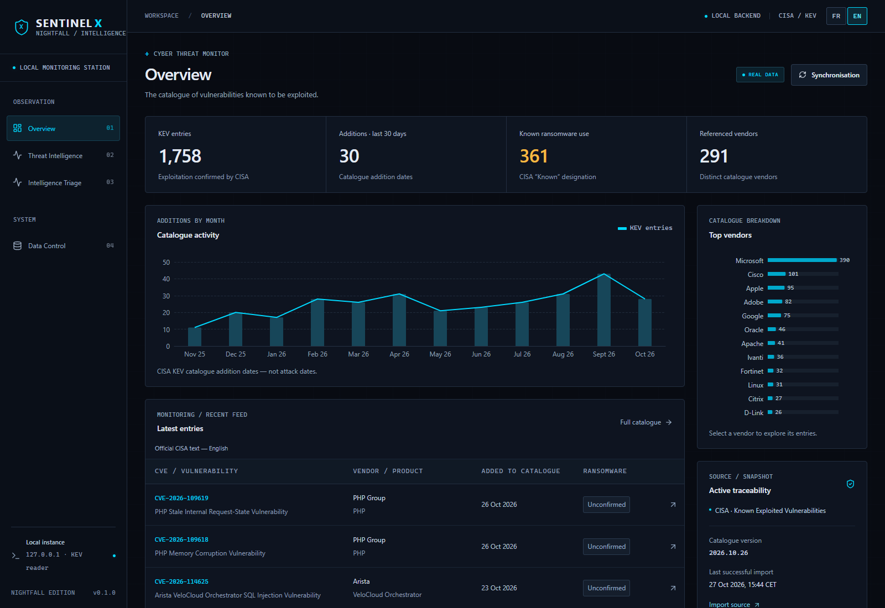

# SENTINEL X — NIGHTFALL

**Prototype open source expérimental de renseignement cyber défensif — JLV LABS.**

Apache-2.0 · [English](README.md) · [Contribuer](CONTRIBUTING.md)

**0.1.0 — First Stable Release.** P0.1, P1-A et P1-B Intelligence Triage sont intégrés. Un numéro source ne publie pas une Release : consulter les [Releases GitHub](https://github.com/JLV-73/sentinel-x/releases) pour les tags et le statut réels. « Stable » désigne la référence sélectionnée, pas une certification de sécurité.

| Version | Ce qui est installé |
|---|---|
| [main — Intelligence Triage](https://github.com/JLV-73/sentinel-x/tree/main) | Cockpit KEV/NVD/EPSS intégré, triage consolidé en lecture seule et filtres indépendants et transparents |
| [Notes sources R3](docs/RELEASE_v0.1.0.md) | Référence source stable, distribution et limites connues ; disponibilité effective dans les Releases GitHub |
| [v0.1.0-alpha.2](https://github.com/JLV-73/sentinel-x/tree/v0.1.0-alpha.2) | Alpha 2 publiée et figée, avec Intelligence Triage |
| [v0.1.0-alpha.1](https://github.com/JLV-73/sentinel-x/tree/v0.1.0-alpha.1) | Première Alpha officielle figée : P0.1 + P1-A, sans le triage P1-B |
| [p0.1-international-stable](https://github.com/JLV-73/sentinel-x/tree/p0.1-international-stable) | Référence historique CISA seule, figée ; tag non déplacé |
| [p1/intelligence-core](https://github.com/JLV-73/sentinel-x/tree/p1/intelligence-core) | Référence de développement P1-A conservée |

**Code source uniquement :** aucune application empaquetée. Les Alpha 1 et 2 et leurs tags
restent inchangés. Aucun exécutable Windows, installateur, conteneur, service hébergé
ou base locale inclus.
L’application tourne chez toi ; tu demandes les données des sources officielles.


*Capture réelle et datée de validation CISA : ni attaques en direct, ni diagnostic de tes appareils.*

## Renseignements inclus — signaux distincts, aucun risque inventé

- **CISA KEV :** import manuel validé, recherche/filtres/pagination/fiches CVE,
  graphiques d'ajouts, provenance et conservation des dernières données valides.
- **NVD/CVSS :** enrichissement manuel ciblé d'une CVE du catalogue local ;
  gravité/vecteur/version/fournisseur séparés, disponibilité et fraîcheur.
- **FIRST EPSS :** actualisation manuelle des identifiants KEV locaux ; probabilité
  d'exploitation à 30 jours, percentile, date source et provenance distincts.
- **NIGHTFALL :** cockpit FR/EN, contrôle des sources, FastAPI/SQLite et React/TypeScript.

Aucune collecte au démarrage, surveillance autonome, analyse réseau, alerte ou score
composite. NVD n'est pas collectée exhaustivement. Après CISA, utiliser la commande
NVD d'une fiche ou les commandes explicites NVD/EPSS du contrôle des sources.
Les lectures GET restent locales.

## Intelligence Triage

Ouvrir **Intelligence Triage** pour rapprocher KEV, toutes les versions/fournisseurs
CVSS et probabilité/percentile EPSS. Recherche, dates inclusives d’ajout au catalogue,
disponibilité, seuils CVSS/EPSS et récence se combinent avec ET.
L’entrée EPSS est un pourcentage (0–100) ; l’API utilise une probabilité (0–1).
Une absence n’est jamais zéro. Les seuils examinent aussi les valeurs conservées
périmées/après erreur : états, dates et provenance restent visibles. Aucun score
composite, recommandation automatique ou diagnostic d’un appareil. Les lignes CISA
seules restent utilisables. Filtres et retour de fiche gardent leur contexte au
changement FR/EN. La consultation effectue uniquement des GET locaux, sans collecte.

Voir le [contrat de triage](docs/TRIAGE_CONTRACT.md) et l’[étude OSV/GHSA](docs/OSV_GHSA_STUDY.md)
pour une éventuelle source future — étude uniquement, aucun connecteur intégré.

## A. ESSAYER SENTINEL X — DÉMARRAGE RAPIDE

### 1. Ouvrir PowerShell normalement et vérifier les prérequis

Windows 11, Git, **Python 3.11**, **Node.js 24** et npm sont nécessaires. Ouvre
PowerShell **sans administrateur**. Ne lance pas l'installation dans Program Files,
Windows ou un autre dossier protégé. Exécute chaque étape numérotée séparément ;
**au premier échec, arrête-toi**, sans lancer les étapes suivantes.

```powershell
$ErrorActionPreference = "Stop"
Set-Location $HOME
git --version
if ($LASTEXITCODE -ne 0) { throw "Git check failed. Stop here." }
py -3.11 --version
if ($LASTEXITCODE -ne 0) { throw "Python 3.11 is required. Stop here." }
node --version
if ($LASTEXITCODE -ne 0) { throw "Node.js 24 is required. Stop here." }
npm.cmd --version
if ($LASTEXITCODE -ne 0) { throw "npm check failed. Stop here." }
```

Les sorties doivent indiquer Git, Python `3.11.x`, Node `v24.x` et une version npm.
Le positionnement explicite quitte le dossier initial de PowerShell pour ton dossier utilisateur.

### 2. Télécharger les sources stables immuables

**Disponibilité :** la commande ci-dessous sera utilisable **après publication du tag `v0.1.0`**.
Vérifier d’abord les [Releases GitHub](https://github.com/JLV-73/sentinel-x/releases).
Un **HEAD détaché est normal** lors du clonage d’un tag de Release immuable.

```powershell
if (Test-Path -LiteralPath .\sentinel-x) { throw "sentinel-x already exists. Use a new parent folder; do not delete it." }
git clone --branch v0.1.0 https://github.com/JLV-73/sentinel-x.git
if ($LASTEXITCODE -ne 0) { throw "Clone failed. Stop here; do not run Python or npm." }
Set-Location .\sentinel-x
```

**Un dossier `sentinel-x` existe déjà ?** Conserve-le. Avant de reprendre l'étape 2,
choisis un parent neuf, par exemple avec ce bloc optionnel (change le nom si
`sentinel-x-work` existe déjà). Ne relance **pas** l'étape 1 ensuite.

```powershell
$AlternativeParent = Join-Path $HOME "sentinel-x-work"
New-Item -ItemType Directory -Path $AlternativeParent -ErrorAction Stop | Out-Null
Set-Location $AlternativeParent
```

L'étape 2 crée un nouveau `sentinel-x` dans ce parent : aucune suppression ni écrasement.

La commande ci-dessus sélectionne un tag de Release, pas une branche de développement mobile.
Pour reproduire l’Alpha 2 publiée et figée, remplacer seulement la ligne de clonage
de l’étape 2 par cette alternative. Un HEAD détaché est normal ; ne pas cloner deux fois.

```powershell
git clone --branch v0.1.0-alpha.2 https://github.com/JLV-73/sentinel-x.git
```

### 3. Installer les dépendances dans le projet

Depuis la **racine du nouveau clone**, atteinte à l'étape 2 :

```powershell
py -3.11 -m venv .venv
if ($LASTEXITCODE -ne 0) { throw "venv creation failed. Stop here." }
New-Item -ItemType Directory -Force -Path .cache/pip,.cache/tmp | Out-Null
$env:TEMP = Join-Path (Get-Location) ".cache/tmp"
$env:TMP = $env:TEMP
.\.venv\Scripts\python.exe -I -m pip --isolated install --cache-dir .cache/pip -r backend/requirements-lock.txt
if ($LASTEXITCODE -ne 0) { throw "Python dependency install failed. Stop here." }
.\.venv\Scripts\python.exe -I tools/bootstrap_schema.py
if ($LASTEXITCODE -ne 0) { throw "Schema bootstrap failed. Stop here." }
npm.cmd --prefix frontend ci
if ($LASTEXITCODE -ne 0) { throw "npm install failed. Stop here." }
```

Versions verrouillées. Venv, dépendances npm et caches restent dans le clone.
`TEMP`/`TMP` ne concernent que cette session PowerShell. Le schéma est externe :
le bootstrap vérifie sa révision officielle épinglée et son SHA-256, sans écraser
un fichier différent. Voir [installation du schéma](docs/SCHEMA_SETUP.md). Aucune clé API nécessaire.

### 4. Démarrer, ouvrir le cockpit et initialiser CISA

```powershell
.\START_SENTINEL.cmd
```

Laisse cette console ouverte. Ouvre toi-même **http://127.0.0.1:5177** dans ton
navigateur. Santé API : http://127.0.0.1:8007/api/health . Le lanceur n'ouvre aucun
navigateur et n'installe aucun service.

**NO DATA est normal après une installation neuve.** Dans le cockpit, ouvre
**DATA CONTROL** ou **CONTRÔLE DES DONNÉES**, puis déclenche la synchronisation CISA
manuelle. Internet est nécessaire. Après réussite, catalogue et graphiques se
remplissent de données officielles validées. Aucune collecte au démarrage ; aucun
jeu fictif dans les indicateurs réels. Un échec conserve les données valides antérieures.

Arrêt : **Ctrl+C dans la console du lanceur**, puis confirmation si Windows la demande.
Les serveurs écoutent uniquement sur `127.0.0.1`. Ne les expose pas publiquement et
n'arrête pas un autre logiciel pour libérer un port.

### Sauvegarde locale à la demande

Depuis la racine du projet, exécute la commande ci-dessous pour créer une sauvegarde SQLite locale à la demande sous `data/backups/`. Conserve-la localement : ne committe ni ne publie l’archive, la base ou les données sources.

```powershell
.\.venv\Scripts\python.exe -I scripts/backup.py
```

## B. CONTRIBUER À SENTINEL X

**Fork → Clone → Branche → Modifications → Tests → Pull Request.**
[CONTRIBUTING.md](CONTRIBUTING.md) détaille le parcours, la branche cible, les tests,
les protections actuelles de main et les contributions Apache-2.0.
Revue et validation avant intégration : **aucune fusion automatique**.
Une vulnérabilité utilise le [signalement privé](SECURITY.md), pas les Issues publiques.

## C. DÉPANNAGE

| Symptôme | Réponse courte |
|---|---|
| `Permission denied` au clone | Arrête-toi. `Set-Location $HOME`, ou parent neuf accessible ci-dessus, puis étape 2. Pas de mode administrateur. |
| Dossier `sentinel-x` existant | Conserve-le ; utilise le parent alternatif, puis l'étape 2. Ne supprime pas une installation pour réessayer à l'aveugle. |
| Python 3.11 introuvable | Vérifie `py --list` ; installe/sélectionne Python 3.11 depuis sa distribution officielle, puis rouvre PowerShell. Pas de venv d'une autre application. |
| Node/npm indisponibles | Vérifie Node.js 24 avec npm et son accès dans PATH ; rouvre PowerShell. Ne continue pas avant réussite des deux contrôles. |
| `npm.ps1` bloqué | Utilise **`npm.cmd`**, déjà employé ici. Aucun changement global de stratégie d'exécution nécessaire. |
| Échec d'installation des dépendances | Arrête cette étape ; conserve la première erreur, vérifie connexion/disponibilité des versions. Ne modifie pas les lockfiles pour forcer. |
| Échec bootstrap/SHA-256 | Arrête-toi, vérifie accès officiel/connexion, conserve le fichier précédent et rapporte l'erreur. Ne désactive ni TLS ni contrôle d'empreinte. |
| Port 5177/8007 occupé | Arrête le lancement de test ; ferme seulement ta console SENTINEL précédente connue, ou demande au responsable du processus. Aucun arrêt de processus inconnu. |
| NO DATA dans le cockpit | Le clone neuf n'inclut pas de base. Lance la synchronisation CISA manuelle ; en cas d'échec, lis la dernière tentative/erreur dans DATA CONTROL. |

## Détails et limites

[Architecture](docs/ARCHITECTURE.md) · [Sources](docs/SOURCES.md) ·
[Roadmap](docs/ROADMAP.md) · [Vérifications](docs/VERIFICATION.md) · [Changelog](CHANGELOG.md)

Aucun scanner, exploit, inventaire/alerte automatique, IA autonome, cockpit hébergé
ou authentification multi-utilisateur. Les ajouts CISA ne comptent pas des attaques ;
les échéances CISA ne sont pas des obligations françaises générales. Les signaux
P1-A restent séparés, avec quotas/fraîcheur et limites documentées. Les phases
futures ne sont pas livrées. Textes officiels et identifiants non traduits.

[Apache License 2.0](LICENSE) pour le code original JLV ; conserver [NOTICE](NOTICE).
[Périmètre des droits](COPYRIGHT.md) et [notices tierces](THIRD_PARTY_NOTICES.md)
séparés. Aucun cache brut ni arbre de dépendances empaqueté n'est distribué.
La sauvegarde à la demande et les commandes de test restent dans
[l'architecture](docs/ARCHITECTURE.md) et le [guide contributeur](CONTRIBUTING.md).
