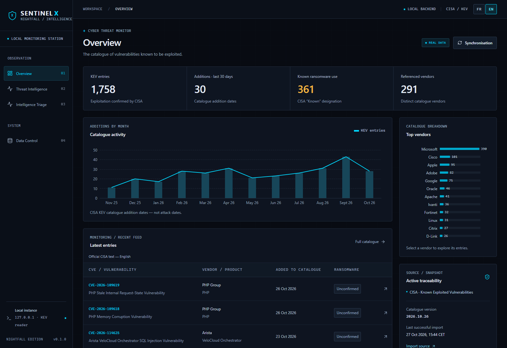

# SENTINEL X — NIGHTFALL

**Experimental defensive open-source cyber intelligence by JLV LABS.**

Apache-2.0 · [Français](README.fr.md) · [Contribute](CONTRIBUTING.md)

## v0.2.1 candidate source overview

`VERSION` and frontend package metadata identify **0.2.1**. This source tree
does not itself establish publication or remote availability; check
[GitHub Releases](https://github.com/JLV-73/sentinel-x/releases). The installation
below is separate from the historical release instructions and version table.

| Area | Status in this source tree | Boundary |
|---|---|---|
| NIGHTFALL / triage | Existing local implementation | Source collection is explicit; see source contracts below. |
| GHSA | Bounded pilot | One requested CVE; not comprehensive coverage. |
| DIGITAL FORTRESS fixture | Experimental local demonstration | Loopback HTTPS and simulated DNS/peer, not an Internet audit. |
| Diagnostic import / report | Experimental local JSON import and HTML export | User-declared observations, not authenticated or independently verified. |
| Internet site analysis | Disabled | URL entry and authorization do not enable analysis; safeguards remain unqualified. |

See [DIGITAL FORTRESS local guide](docs/DIGITAL_FORTRESS_LOCAL.md),
[historical v0.2.0 release notes FR](docs/RELEASE_v0.2.0.fr.md) /
[EN](docs/RELEASE_v0.2.0.md). The v0.2.1 identity candidate is not itself a published release.
“Implemented” is a source description, not a
claim of a fresh runtime validation, security certification or production readiness.

## Install candidate source (Windows)

Use a new, writable, isolated directory, never an operational checkout or its data.
Use normal PowerShell, not administrator mode. Windows 11, Git, Python 3.11,
Node.js 24 and npm are prerequisites; check `git --version`, `py -3.11 --version`,
`node --version` and `npm.cmd --version`. Stop on any error. The commands below
are PowerShell, not cmd.exe or Git Bash.

1. **Choose one source**, then open PowerShell in its root. For uncommitted changes,
   use a separately prepared source-only copy of the *complete current
   working tree*, including untracked candidate files; exclude `.git`, `.venv`,
   `node_modules`, caches, databases, backups and other private data. A Git clone
   alone does not include uncommitted or untracked files. Alternatively, when
   the exact commit exists locally, clone its local repository into a
   new directory and check out that exact commit. Substitute the actual local path,
   new destination and verified full commit SHA below; they are not a remote release:

   ```powershell
   $ErrorActionPreference = "Stop"
   $Source = 'C:\path\to\local\repository'
   $Destination = 'C:\path\to\new\sentinel-x-candidate'
   $CandidateCommit = '<verified-full-candidate-commit-sha>'
   if (Test-Path -LiteralPath $Destination) { throw "Destination exists; choose a new directory." }
   git clone --no-checkout -- "$Source" "$Destination"
   if ($LASTEXITCODE -ne 0) { throw "Local clone failed." }
   Set-Location -LiteralPath $Destination
   git checkout --detach $CandidateCommit
   if ($LASTEXITCODE -ne 0) { throw "Candidate checkout failed." }
   git rev-parse HEAD
   if ($LASTEXITCODE -ne 0) { throw "Commit verification failed." }
   ```

   Check that the printed HEAD is the verified candidate SHA. Detached HEAD is
   expected; a commit checkout does not include uncommitted changes.

   **Published stable alternative (v0.2.0, without the v0.2.1 identity changes):**
   only once `v0.2.0` is actually published,
   confirm the tag and Release on GitHub Releases, then from a new writable parent:

   ```powershell
   if (Test-Path -LiteralPath .\sentinel-x) { throw "sentinel-x already exists. Use a new parent folder; do not delete it." }
   git clone --branch v0.2.0 https://github.com/JLV-73/sentinel-x.git
   if ($LASTEXITCODE -ne 0) { throw "Clone failed. Stop here." }
   Set-Location .\sentinel-x
   ```

   A detached HEAD is normal. Continue at step 2 from the new clone root.
2. From the chosen source-copy or clone root, install the locked dependencies:

   ```powershell
   $ErrorActionPreference = "Stop"
   py -3.11 -m venv .venv
   if ($LASTEXITCODE -ne 0) { throw "venv creation failed." }
   New-Item -ItemType Directory -Force -Path .cache/pip,.cache/tmp,.cache/npm | Out-Null
   $env:TEMP = Join-Path (Get-Location) ".cache/tmp"
   $env:TMP = $env:TEMP
   $env:npm_config_cache = Join-Path (Get-Location) ".cache/npm"
   .\.venv\Scripts\python.exe -I -m pip --isolated install --cache-dir .cache/pip -r backend/requirements-lock.txt
   if ($LASTEXITCODE -ne 0) { throw "Python dependency install failed." }
   npm.cmd --prefix frontend ci --no-audit --no-fund
   if ($LASTEXITCODE -ne 0) { throw "npm install failed." }
   ```

   The Python lock and `frontend/package-lock.json` determine versions. These
   installs may require Internet or appropriately populated local package caches;
   no network access is implied by this documentation. Environment changes apply
   only to this PowerShell session.
3. **Acquire the CISA validation schema**, distinct from the KEV catalogue:

   ```powershell
   .\.venv\Scripts\python.exe -I tools/bootstrap_schema.py
   if ($LASTEXITCODE -ne 0) { throw "Schema bootstrap failed." }
   ```

   The schema is not in Git. Bootstrap downloads the pinned official revision over
   HTTPS and verifies its SHA-256, or verifies an already present matching local
   file without network; it never overwrites different bytes. Offline, supply the
   exact verified schema locally at `backend/app/kev_schema.json` first; otherwise
   stop. See [schema setup](docs/SCHEMA_SETUP.md); do not bypass TLS or the hash.
4. Start with `.\START_SENTINEL.cmd` and open `http://127.0.0.1:5177` yourself;
   health is at `http://127.0.0.1:8007/api/health`. The local database is not
   distributed: a fresh installation starts with **NO DATA**. A manual CISA sync
   in DATA CONTROL is optional and needs Internet; no collection starts on launch.
   Internet site auditing stays disabled, including when a URL and authorization
   are provided. The experimental loopback fixture is not an Internet audit. Keep
   the launcher console open; stop it from that console. Never expose these local
   services publicly or terminate an unrelated process to free a port.

**0.1.1 — GHSA Intelligence Edition.** P1-C is integrated into main by PR #9: targeted, explicitly requested GitHub reviewed advisories complement CISA KEV, NVD/CVSS and FIRST EPSS. The v0.1.1 tag and Release were published; check [GitHub Releases](https://github.com/JLV-73/sentinel-x/releases) for availability. Earlier stable v0.1.0 and both Alpha releases remain preserved. “Stable” is not a security certification.

| Version | What you install |
|---|---|
| [0.1.1 source notes](docs/RELEASE_v0.1.1.md) | GHSA Intelligence Edition baseline; actual tag/Release availability is recorded on GitHub Releases |
| [p1c/ghsa-intelligence](https://github.com/JLV-73/sentinel-x/tree/p1c/ghsa-intelligence) | Preserved P1-C development reference, integrated by PR #9; not a release tag |
| [v0.1.0](https://github.com/JLV-73/sentinel-x/tree/v0.1.0) | Published First Stable Release, without the GHSA pilot |
| [main — GHSA Intelligence](https://github.com/JLV-73/sentinel-x/tree/main) | Integrated KEV/NVD/EPSS/GHSA cockpit, read-only triage and explicit targeted enrichment |
| [R3 source notes](docs/RELEASE_v0.1.0.md) | Stable source baseline, distribution and known limitations; GitHub Releases records actual availability |
| [v0.1.0-alpha.2](https://github.com/JLV-73/sentinel-x/tree/v0.1.0-alpha.2) | Published frozen Alpha 2, with Intelligence Triage |
| [v0.1.0-alpha.1](https://github.com/JLV-73/sentinel-x/tree/v0.1.0-alpha.1) | Frozen first official Alpha: P0.1 + P1-A, without the P1-B triage view |
| [p0.1-international-stable](https://github.com/JLV-73/sentinel-x/tree/p0.1-international-stable) | Frozen CISA-only historical baseline; its tag is not moved |
| [p1/intelligence-core](https://github.com/JLV-73/sentinel-x/tree/p1/intelligence-core) | Preserved P1-A development reference |

**Source-only checkout:** no packaged application. Alpha 1, Alpha 2 and their tags remain
unchanged. No Windows executable, installer, container, hosted service or local
database is included.
You run the application locally and request official-source data yourself.


*Real, dated CISA validation capture — not a live attack feed or personal-device diagnosis.*

## Included intelligence — separate signals, no invented risk score

- **CISA KEV:** validated manual catalogue import, search/filter/pagination/CVE
  details, charts of catalogue additions, provenance and last-valid-data retention.
- **NVD/CVSS:** manual targeted enrichment for an existing local KEV CVE;
  severity/vector/version/provider remain distinct, with availability/freshness.
- **FIRST EPSS:** manual refresh for local KEV identifiers; 30-day exploitation
  probability, percentile, source date and provenance remain separate.
- **GHSA:** explicit anonymous reviewed-advisory lookup for one local CVE, original
  package ranges/fixes, dates, withdrawals, severity and cache provenance; CC-BY-4.0 attribution.
- **NIGHTFALL:** FR/EN cockpit, source-control view, FastAPI/SQLite and React/TypeScript.

No startup collection, autonomous monitoring, scanner, alerting or composite score.
NVD is not fetched exhaustively. After CISA sync, use a CVE detail's NVD control
or the Intelligence Sources view's explicit NVD/EPSS controls; GET reads stay local.

## Intelligence Triage

Open **Intelligence Triage** to read KEV, every CVSS version/provider and EPSS
probability/percentile together. Search, inclusive catalogue date ranges, source
availability, CVSS/EPSS thresholds and recency criteria combine with AND.
EPSS input is percent (0–100); the API uses probability (0–1). Missing is never zero.
Numeric thresholds also examine retained stale/error values: their states, dates
and provenance stay visible. They are not a recommendation or a composite risk score.
CISA-only rows remain usable. Filters and detail/back navigation preserve context
when switching FR/EN. Browsing performs local GETs only, never external collection.

See [the triage contract](docs/TRIAGE_CONTRACT.md) and the historical
[OSV/GHSA study](docs/OSV_GHSA_STUDY.md). P1-C implements GHSA only; OSV remains excluded.

## GHSA pilot — explicit CVE lookup only

Open an existing CVE detail and explicitly request GitHub reviewed advisories.
The panel preserves advisory IDs, packages/ecosystems, affected ranges, first fixes,
source dates, withdrawal status and original severity/vector information. Multiple
advisories remain separate; an empty result, an unrequested lookup, source failure
and stale/retained data are not interchangeable. No device exposure is inferred.

One anonymous official API page (100 advisories maximum) per explicit lookup, with
a persistent minimum 65-second interval and provider cooldown handling. A further
page is reported as a pilot limit, not silently omitted. There is no key requirement,
catalogue-wide collection, automatic retry or background job. Viewing/changing language
only reads the local cache. GitHub Advisory Database data is **CC-BY-4.0**, separate
from this project’s Apache-2.0 code; attribution and the original JSON remain available.
See [the bounded pilot contract](docs/GHSA_PILOT_CONTRACT.md).

**Installation choice:** the historical quick start selects published `v0.1.1`.
The earlier published stable `v0.1.0` (without GHSA) is an alternative: replace only `--branch v0.1.1` with
`--branch v0.1.0` in step 2. Always use a **new isolated directory** and retain
every prerequisite and safeguard; never reuse an operational checkout or its data.

## A. TRY SENTINEL X — HISTORICAL RELEASE QUICK START

### 1. Open normal PowerShell and verify prerequisites

Windows 11, Git, **Python 3.11**, **Node.js 24** and npm are required. Use normal
PowerShell, **not administrator mode**. Do not start an installation in Program
Files, Windows or another protected directory. Run each numbered step separately;
**if anything fails, stop there** instead of running the following steps.

```powershell
$ErrorActionPreference = "Stop"
Set-Location $HOME
git --version
if ($LASTEXITCODE -ne 0) { throw "Git check failed. Stop here." }
py -3.11 --version
if ($LASTEXITCODE -ne 0) { throw "Python 3.11 is required. Stop here." }
node --version
if ($LASTEXITCODE -ne 0) { throw "Node.js 24 is required. Stop here." }
npm.cmd --version
if ($LASTEXITCODE -ne 0) { throw "npm check failed. Stop here." }
```

The outputs must show Git, Python `3.11.x`, Node `v24.x` and an npm version.
This explicitly leaves any initial PowerShell directory and uses your user home.

### 2. Download the immutable stable source

**Availability:** the `v0.1.1` tag has been published.
Check [GitHub Releases](https://github.com/JLV-73/sentinel-x/releases) first.
A **detached HEAD is normal** when checking out an immutable release tag.

```powershell
if (Test-Path -LiteralPath .\sentinel-x) { throw "sentinel-x already exists. Use a new parent folder; do not delete it." }
git clone --branch v0.1.1 https://github.com/JLV-73/sentinel-x.git
if ($LASTEXITCODE -ne 0) { throw "Clone failed. Stop here; do not run Python or npm." }
Set-Location .\sentinel-x
```

**Already have a `sentinel-x` folder?** Keep it. Before retrying step 2, select a
fresh parent, for example with the following optional block (use another unused
name if `sentinel-x-work` already exists). Do **not** rerun step 1 afterwards.

```powershell
$AlternativeParent = Join-Path $HOME "sentinel-x-work"
New-Item -ItemType Directory -Path $AlternativeParent -ErrorAction Stop | Out-Null
Set-Location $AlternativeParent
```

Step 2 will create a new `sentinel-x` inside that parent; nothing is deleted or overwritten.

The command above selects a release tag, not a moving development branch.
To reproduce frozen published Alpha 2 instead, replace only the clone line in
step 2 with the following alternative. A detached HEAD is normal; do not clone twice.

```powershell
git clone --branch v0.1.0-alpha.2 https://github.com/JLV-73/sentinel-x.git
```

### 3. Install project-local dependencies

Run from the **new clone root** reached in step 2:

```powershell
py -3.11 -m venv .venv
if ($LASTEXITCODE -ne 0) { throw "venv creation failed. Stop here." }
New-Item -ItemType Directory -Force -Path .cache/pip,.cache/tmp | Out-Null
$env:TEMP = Join-Path (Get-Location) ".cache/tmp"
$env:TMP = $env:TEMP
.\.venv\Scripts\python.exe -I -m pip --isolated install --cache-dir .cache/pip -r backend/requirements-lock.txt
if ($LASTEXITCODE -ne 0) { throw "Python dependency install failed. Stop here." }
.\.venv\Scripts\python.exe -I tools/bootstrap_schema.py
if ($LASTEXITCODE -ne 0) { throw "Schema bootstrap failed. Stop here." }
npm.cmd --prefix frontend ci
if ($LASTEXITCODE -ne 0) { throw "npm install failed. Stop here." }
```

Versions stay locked. The venv, npm dependencies and caches are inside the clone.
`TEMP`/`TMP` affect only this PowerShell session. The schema is an external resource:
bootstrap checks its pinned official revision and SHA-256, never overwriting a
different existing file. See [schema setup](docs/SCHEMA_SETUP.md). No API key is needed.

### 4. Start, open the cockpit, then initialize CISA

```powershell
.\START_SENTINEL.cmd
```

Keep that console open. Open **http://127.0.0.1:5177** yourself in a browser.
API health: http://127.0.0.1:8007/api/health . The launcher opens no browser and installs no service.

**NO DATA is expected in a fresh installation.** In the cockpit, open
**DATA CONTROL** (or **CONTRÔLE DES DONNÉES**) and use the manual **Synchronize CISA**
action. Internet access is required. After success, the catalogue/charts populate
with validated official data. Startup does not collect sources; demo fixtures
never silently feed real indicators. A failed collection preserves any prior valid data.

Stop with **Ctrl+C in the launcher console**; confirm if Windows asks. Both servers
bind only `127.0.0.1`. Never expose them publicly or kill another app to free a port.

### Local backup — on demand

From the project root, run the command below to create an on-demand local SQLite backup under `data/backups/`. Keep the backup local: do not commit or publish its archive, database or source data.

```powershell
.\.venv\Scripts\python.exe -I scripts/backup.py
```

## B. CONTRIBUTE TO SENTINEL X

**Fork → Clone → Branch → Changes → Tests → Pull Request.**
Read [CONTRIBUTING.md](CONTRIBUTING.md) for the exact workflow, target branch,
local checks, main's current protection and Apache-2.0 contribution terms.
Changes need review and validation before integration; **no automatic merge**.
Security findings use [private reporting](SECURITY.md), not ordinary public Issues.

## C. TROUBLESHOOTING

| Symptom | Short response |
|---|---|
| `Permission denied` during clone | Stop. Use `Set-Location $HOME`, or a fresh writable parent as above, then retry step 2. Do not use admin mode. |
| Existing `sentinel-x` folder | Keep it; use the alternative-parent block, then step 2. Never delete an installation to retry blindly. |
| Python 3.11 not found | Check `py --list`; install/select Python 3.11 from the official Python distribution, then reopen PowerShell. Do not reuse an unrelated venv. |
| Node/npm unavailable | Confirm Node.js 24 with npm is installed and on PATH; reopen PowerShell. Do not continue until both checks work. |
| `npm.ps1` blocked | Use **`npm.cmd`**, as these commands already do. No global execution-policy change is needed. |
| Dependency install fails | Stop at that step; keep the first error and check connectivity/version availability. Do not change lockfiles to force success. |
| Bootstrap/SHA-256 failure | Stop. Check official-source access/connectivity, keep any previous file, and report the error. Never disable TLS or replace the expected hash. |
| Port 5177/8007 occupied | Stop the test launch; close only your own known earlier SENTINEL console, or ask the port owner's administrator. Never terminate an unknown process. |
| Cockpit shows NO DATA | First installation has no database. Run the manual CISA sync; if it fails, read DATA CONTROL's attempt/error state. |

## Details and boundaries

[Architecture](docs/ARCHITECTURE.md) · [Sources](docs/SOURCES.md) ·
[Roadmap](docs/ROADMAP.md) · [Verification](docs/VERIFICATION.md) · [Changelog](CHANGELOG.md)

No scanner, exploit, automatic inventory/alert, autonomous AI, hosted dashboard or
multi-user authentication is implemented. CISA additions are not attack counts;
CISA due dates are not general French legal deadlines. P1-A signals remain separate,
with quotas/freshness and documented prototype limits. Future phases are roadmap,
not delivered features. Source texts/identifiers are not translated.

[Apache License 2.0](LICENSE) covers JLV-owned original code; retain [NOTICE](NOTICE).
[Copyright scope](COPYRIGHT.md) and [third-party notices](THIRD_PARTY_NOTICES.md)
remain separate. No raw source cache or packaged dependency tree is distributed.
On-demand backup instructions and contributor test commands remain in the existing
[architecture](docs/ARCHITECTURE.md) and [contribution guide](CONTRIBUTING.md).
