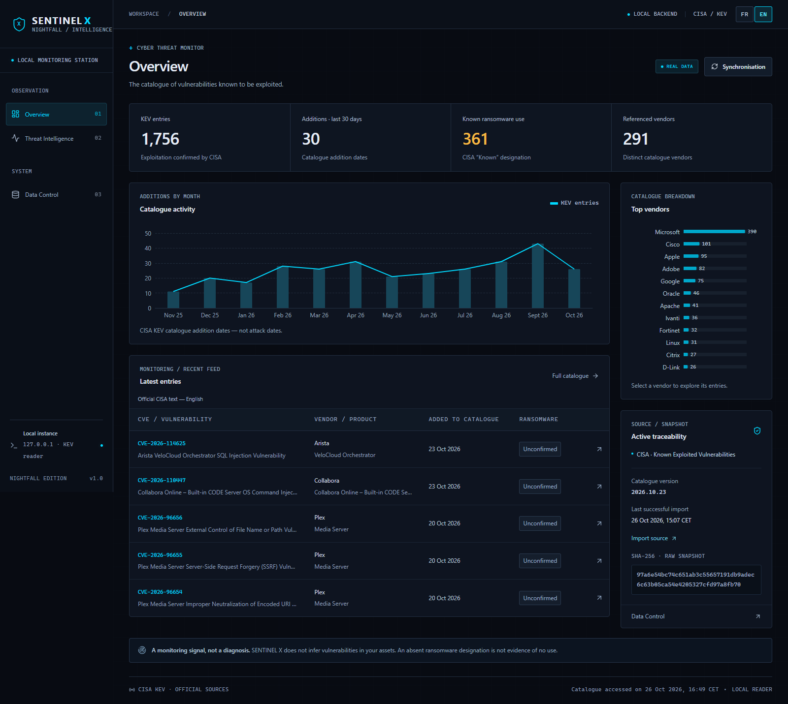

# SENTINEL X — NIGHTFALL

**Experimental defensive open-source cyber intelligence by JLV LABS.**

Apache-2.0 · [Français](README.fr.md) · [Contribute](CONTRIBUTING.md)

**You are reading MAIN — P0.1 INTERNATIONAL EDITION (stable).**

| Version | What you install |
|---|---|
| [main — P0.1 INTERNATIONAL EDITION](https://github.com/JLV-73/sentinel-x/tree/main) | Stable CISA KEV catalogue, bilingual cockpit, search, charts and source provenance |
| [P1-A — INTELLIGENCE CORE](https://github.com/JLV-73/sentinel-x/tree/p1/intelligence-core) | Experimental branch adding targeted NVD/CVSS and FIRST EPSS; **not merged into main** |

Source code only: **no official Release, Windows executable, hosted service or
local database is included**. You run the application locally and request data yourself.


*Real, dated CISA validation capture — not a live attack feed or personal-device diagnosis.*

## A. TRY SENTINEL X — QUICK START

### 1. Open normal PowerShell and verify prerequisites

Windows 11, Git, **Python 3.11**, **Node.js 24** and npm are required. Use normal
PowerShell, **not administrator mode**. Do not start an installation in Program
Files, Windows or another protected directory. Run each numbered step separately;
**if anything fails, stop there** instead of running the following steps.

```powershell
$ErrorActionPreference = "Stop"
Set-Location $HOME
git --version
if ($LASTEXITCODE -ne 0) { throw "Git check failed. Stop here." }
py -3.11 --version
if ($LASTEXITCODE -ne 0) { throw "Python 3.11 is required. Stop here." }
node --version
if ($LASTEXITCODE -ne 0) { throw "Node.js 24 is required. Stop here." }
npm.cmd --version
if ($LASTEXITCODE -ne 0) { throw "npm check failed. Stop here." }
```

The outputs must show Git, Python `3.11.x`, Node `v24.x` and an npm version.
This explicitly leaves any initial PowerShell directory and uses your user home.

### 2. Download this version

```powershell
if (Test-Path -LiteralPath .\sentinel-x) { throw "sentinel-x already exists. Use a new parent folder; do not delete it." }
git clone https://github.com/JLV-73/sentinel-x.git
if ($LASTEXITCODE -ne 0) { throw "Clone failed. Stop here; do not run Python or npm." }
Set-Location .\sentinel-x
```

**Already have a `sentinel-x` folder?** Keep it. Before retrying step 2, select a
fresh parent, for example with the following optional block (use another unused
name if `sentinel-x-work` already exists). Do **not** rerun step 1 afterwards.

```powershell
$AlternativeParent = Join-Path $HOME "sentinel-x-work"
New-Item -ItemType Directory -Path $AlternativeParent -ErrorAction Stop | Out-Null
Set-Location $AlternativeParent
```

Step 2 will create a new `sentinel-x` inside that parent; nothing is deleted or overwritten.

### 3. Install project-local dependencies

Run from the **new clone root** reached in step 2:

```powershell
py -3.11 -m venv .venv
if ($LASTEXITCODE -ne 0) { throw "venv creation failed. Stop here." }
New-Item -ItemType Directory -Force -Path .cache/pip,.cache/tmp | Out-Null
$env:TEMP = Join-Path (Get-Location) ".cache/tmp"
$env:TMP = $env:TEMP
.\.venv\Scripts\python.exe -I -m pip --isolated install --cache-dir .cache/pip -r backend/requirements-lock.txt
if ($LASTEXITCODE -ne 0) { throw "Python dependency install failed. Stop here." }
.\.venv\Scripts\python.exe -I tools/bootstrap_schema.py
if ($LASTEXITCODE -ne 0) { throw "Schema bootstrap failed. Stop here." }
npm.cmd --prefix frontend ci
if ($LASTEXITCODE -ne 0) { throw "npm install failed. Stop here." }
```

Versions stay locked. The venv, npm dependencies and caches are inside the clone.
`TEMP`/`TMP` affect only this PowerShell session. The schema is an external resource:
bootstrap checks its pinned official revision and SHA-256, never overwriting a
different existing file. See [schema setup](docs/SCHEMA_SETUP.md). No API key is needed.

### 4. Start, open the cockpit, then initialize CISA

```powershell
.\START_SENTINEL.cmd
```

Keep that console open. Open **http://127.0.0.1:5177** yourself in a browser.
API health: http://127.0.0.1:8007/api/health . The launcher opens no browser and installs no service.

**NO DATA is expected in a fresh installation.** In the cockpit, open
**DATA CONTROL** (or **CONTRÔLE DES DONNÉES**) and use the manual **Synchronize CISA**
action. Internet access is required. After success, the catalogue/charts populate
with validated official data. Startup does not collect sources; demo fixtures
never silently feed real indicators. A failed collection preserves any prior valid data.

Stop with **Ctrl+C in the launcher console**; confirm if Windows asks. Both servers
bind only `127.0.0.1`. Never expose them publicly or kill another app to free a port.

## B. CONTRIBUTE TO SENTINEL X

**Fork → Clone → Branch → Changes → Tests → Pull Request.**
Read [CONTRIBUTING.md](CONTRIBUTING.md) for the exact workflow, target branch,
local checks, main's current protection and Apache-2.0 contribution terms.
Changes need review and validation before integration; **no automatic merge**.
Security findings use [private reporting](SECURITY.md), not ordinary public Issues.

## C. TROUBLESHOOTING

| Symptom | Short response |
|---|---|
| `Permission denied` during clone | Stop. Use `Set-Location $HOME`, or a fresh writable parent as above, then retry step 2. Do not use admin mode. |
| Existing `sentinel-x` folder | Keep it; use the alternative-parent block, then step 2. Never delete an installation to retry blindly. |
| Python 3.11 not found | Check `py --list`; install/select Python 3.11 from the official Python distribution, then reopen PowerShell. Do not reuse an unrelated venv. |
| Node/npm unavailable | Confirm Node.js 24 with npm is installed and on PATH; reopen PowerShell. Do not continue until both checks work. |
| `npm.ps1` blocked | Use **`npm.cmd`**, as these commands already do. No global execution-policy change is needed. |
| Dependency install fails | Stop at that step; keep the first error and check connectivity/version availability. Do not change lockfiles to force success. |
| Bootstrap/SHA-256 failure | Stop. Check official-source access/connectivity, keep any previous file, and report the error. Never disable TLS or replace the expected hash. |
| Port 5177/8007 occupied | Stop the test launch; close only your own known earlier SENTINEL console, or ask the port owner's administrator. Never terminate an unknown process. |
| Cockpit shows NO DATA | First installation has no database. Run the manual CISA sync; if it fails, read DATA CONTROL's attempt/error state. |

## Details and boundaries

[Architecture](docs/ARCHITECTURE.md) · [Sources](docs/SOURCES.md) ·
[Roadmap](docs/ROADMAP.md) · [Verification](docs/VERIFICATION.md) · [Changelog](CHANGELOG.md)

No scanner, exploit, automatic inventory/alert, autonomous AI, hosted dashboard or
multi-user authentication is implemented. CISA additions are not attack counts;
CISA due dates are not general French legal deadlines. P1-A signals remain separate,
with quotas/freshness and documented prototype limits. Future phases are roadmap,
not delivered features. Source texts/identifiers are not translated.

[Apache License 2.0](LICENSE) covers JLV-owned original code; retain [NOTICE](NOTICE).
[Copyright scope](COPYRIGHT.md) and [third-party notices](THIRD_PARTY_NOTICES.md)
remain separate. No raw source cache or packaged dependency tree is distributed.
On-demand backup instructions and contributor test commands remain in the existing
[architecture](docs/ARCHITECTURE.md) and [contribution guide](CONTRIBUTING.md).
